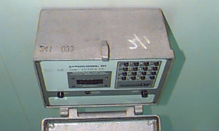
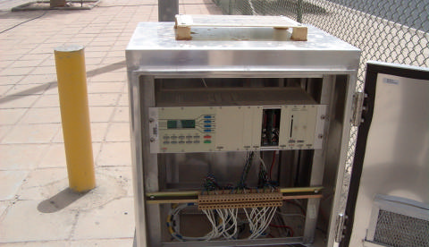
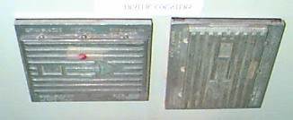
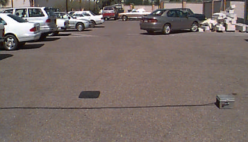
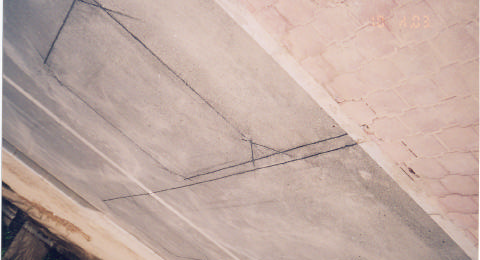
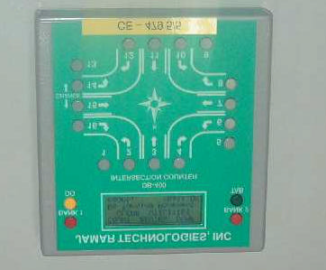
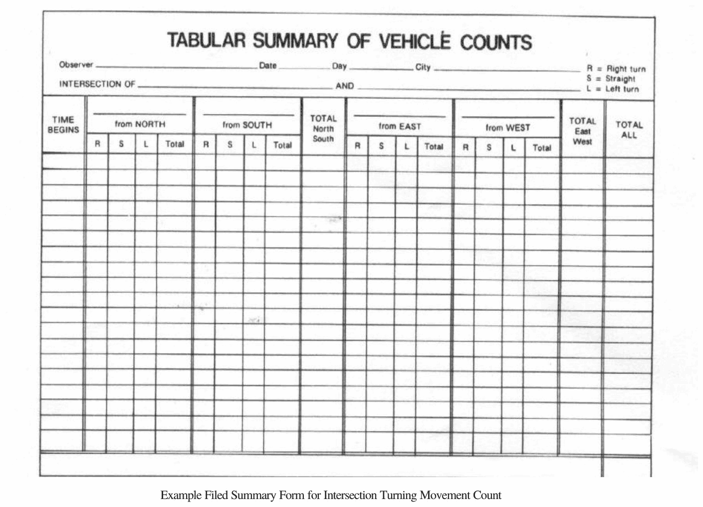
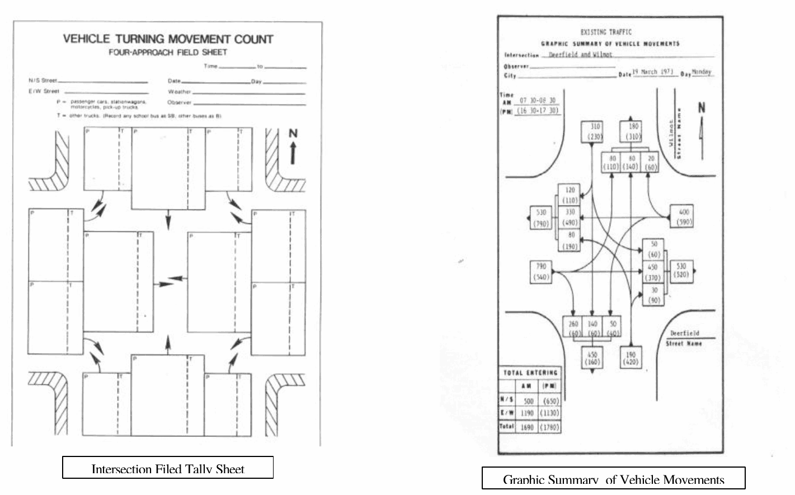
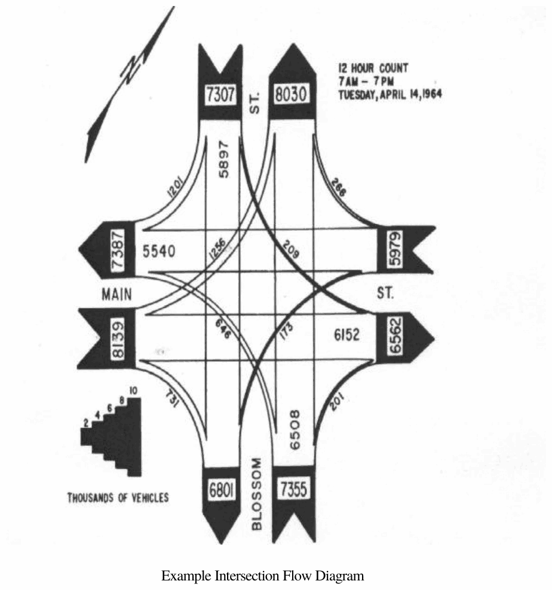
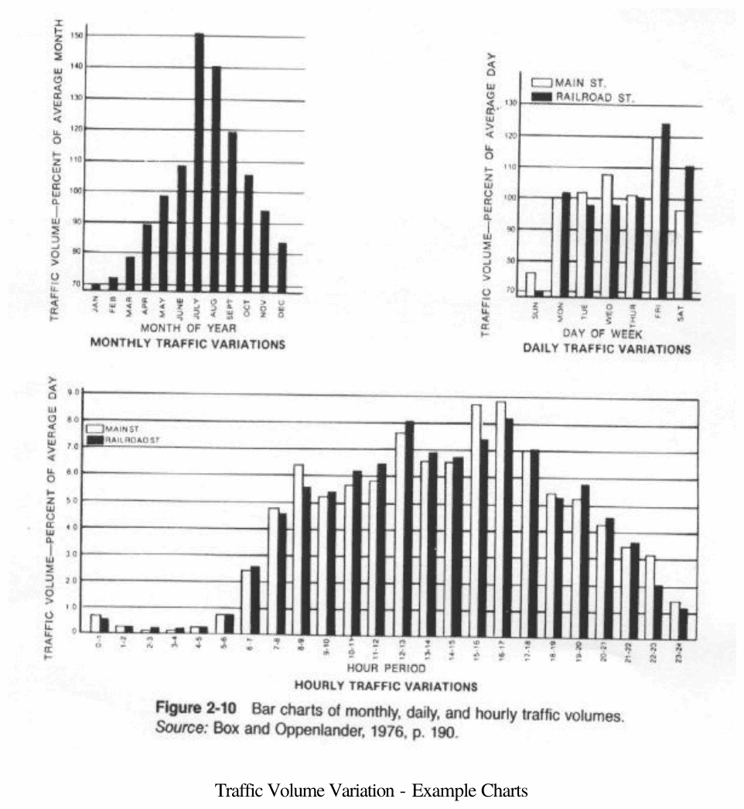

# Chapter 1 — Traffic Volume Studies

> CE 366 Transportation Engineering Laboratory. Converted to Markdown from `1-Traffic Volume.pdf`; the original wording is kept as printed.

## 1.1 Introduction

Traffic volume studies are conducted to collect data on the number of vehicles and/or pedestrians that pass a point on a highway facility during a specified time period. This time period varies from as a little as 15 min. to as much as a year, depending on the purpose of the survey. The data collected may also be put in such class like directional movement occupancy rates and vehicle classification. The following traffic volume characteristics may be collected from Traffic volume studies.

a) **Average Annual Daily traffic. (AADT)** is the average of 24-hr counts collected every day in the year. AADT may be useful in estimation of highway user revenues, computation of accident rate, established of volume trends and for improvement and maintenance programs.

b) **Average Daily Traffic (AADT)** is the average of 24-hour counts collected over a number of days greater than, but less than a year ADT may be used for planning of highway activities, measurement of current demand and evaluation of existing traffic flow.

c) **Peak hour volume (PHV)** is the maximum number of vehicles that pass a point on a highway during a period of 60 consecutive minutes. PHVs are used for functional classification on highways, geometric design, traffic operations and management.

d) **Vehicle miles of Travel (VMT)** is a measure of travel along a section of road. It is the product of the traffic volume and the length of roadway in miles or kilometers to which the volume is applicable. VMTs are used mainly as a base for maintenance and improvement decisions.

## 1.2 Objectives

1. To determine the peak hour volume and composition (Vehicle mix) at the given location (mid-block) of a given road/street.
2. To determine turning movement volume at a given intersection.

## 1.3 Methods of Volume Count

a) **Manual Method:** This method consists in a person recording each vehicle by making tally marks on the field data sheet.

b) **Automatic methods:** This method involves the laying of surface detectors (such as pneumatic road tubes) or surface detectors (such as magnetic or electric contact devices) on the road. These detect the passing vehicle and transmit the information to a recorder, which is connected to the detector at the side of the road. Pneumatic road tubes are employed by counters like those from PEEK Inc. (Figure 1.1, Figure 1.2), and magnetic detectors are used by Hi-star NC-97 from Nu-Metrics Figure (1.2), turning movements study at an intersection is conducted using Jamar Technologies Traffic Counter.

*Fig. 1.1 PEEK Model 241 Counter*

*Figure 1.2 ADR 3000 Counters from PEEK*

*Figure 1.3 Numetrics Count Card*

*Figure 1.4 Tube and Count Card Systems* (labelled in the original: Nu_Metrics Counter, Pneumatic Tube, Traffic Monitor)

*Figure 1.5 Traffic Detection Loop*

*Figure 1.6 Intersection Counter*

## 1.4 Equipment

For manual method the following equipment are needed

1. Stop Watch
2. Pencils, erasers
3. Blank Data Sheets
4. Chip board
5. Mechanical counters
6. Turning Movement Counters

## 1.5 Procedure of Manual Traffic Count

### a) Mid-Block Traffic Count

1. Prepare data sheets
2. Organize the study teams and assign type of data collected to each member of team
3. Each member should station himself/herself at the study site in a convenient but SAFE location.
4. Start counting the assigned type of traffic simultaneously using mechanical counters and/or by directly inputting in the data sheets.
5. Stop the count at the end of 15 minute period and assemble the data in a single data sheet for each team.

### b) Intersection Traffic Count

1. Prepare data sheets
2. Organize the study teams and assign type of data collected to each member of team
3. Each member should station himself/herself at the study site in a convenient but SAFE location.
4. Start counting the assigned type of traffic simultaneously using mechanical counters and/or by directly inputting in the data sheets.
5. Stop the count at the end of 15 minute period and assemble the data in a single data sheet for each team.

## Data Presentation

### a) Mid-Block Traffic Count

1. Report the peak hour volume in vehicles/hour and PCE/hour present it graphically.
2. Report the composition of traffic and represent it graphically.
3. Report the Directional and Lane-wise distribution of Traffic graphically.

### b) Intersection Traffic Count

1. Present a graphic summary of vehicle turning movements.
2. Present intersection flow diagram.

---

## Field Data Sheet for Mid-Block Traffic Volume Count

*CE 366 Transportation Engineering Laboratory*

| | | | |
|---|---|---|---|
| **Count Station:** | | **Time:** | |
| **Road Classification:** | | **Period:** | |
| **Direction of Traffic:** | | | |

| Lane No. | Cars, Jeeps | Buses | Trucks | Rec. Vehicles | Half Lorry & Vannets | Others |
|---|---|---|---|---|---|---|
| | | | | | | |
| | | | | | | |
| | | | | | | |

## Examples

*Example Filed Summary Form for Intersection Turning Movement Count*

*Intersection Filed Tally Sheet (left) and Graphic Summary of Vehicle Movements (right)*

*Example Intersection Flow Diagram*

*Traffic Volume Variation - Example Charts*
