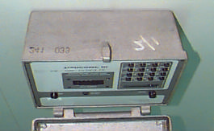
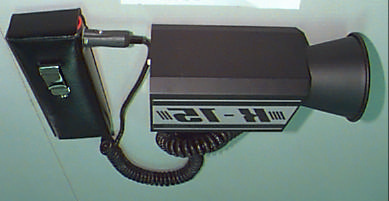
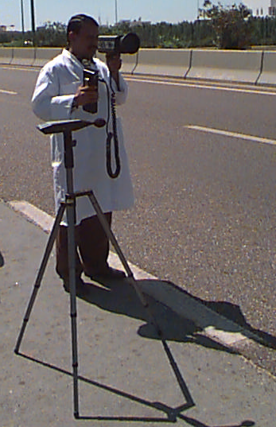
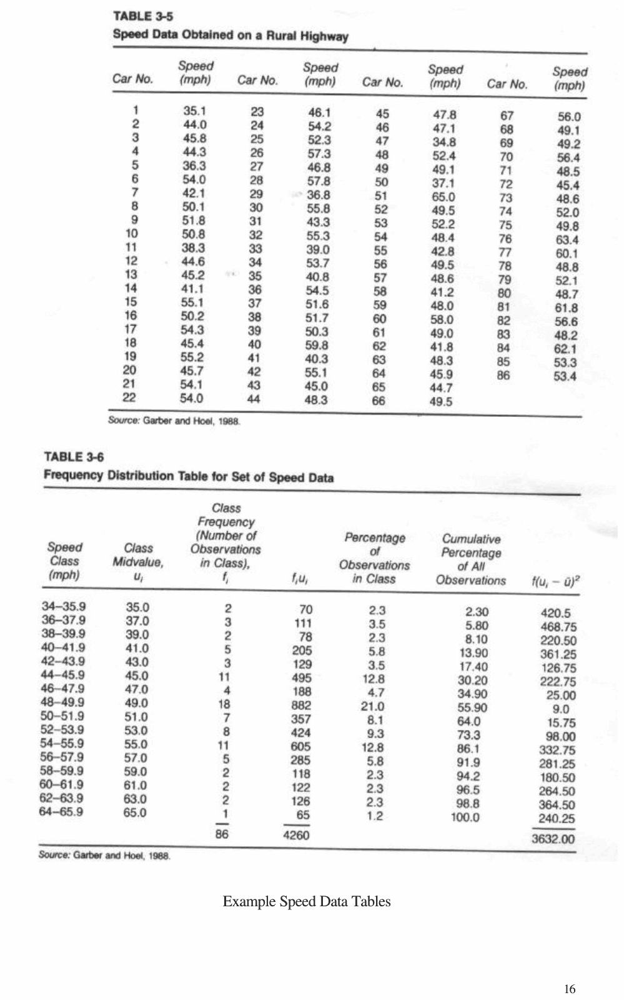
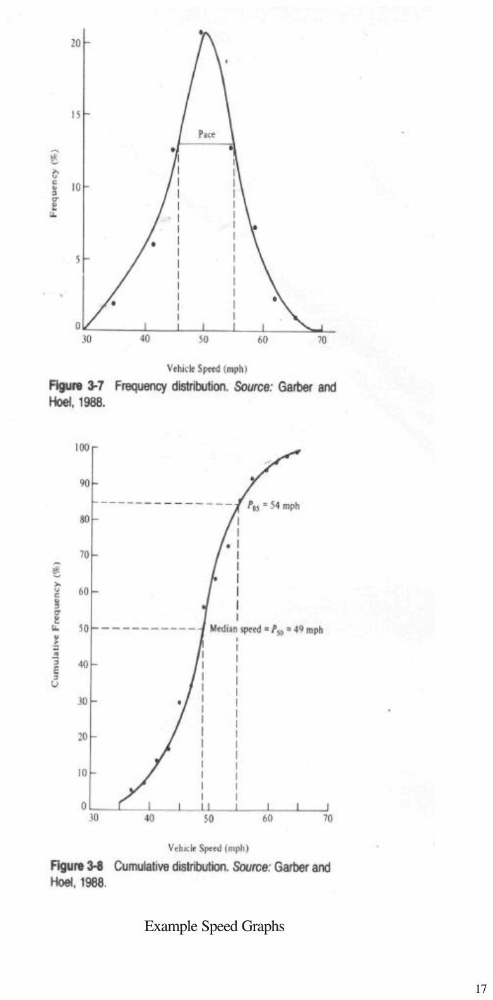

# Chapter 2 — Spot Speed Studies

> CE 366 Transportation Engineering Laboratory. Converted to Markdown from `2-Speed studies.pdf`; the original wording is kept as printed.

## 2.1 Introduction

Spot speed studies are conducted to estimate the distribution of speeds of vehicles in a stream of traffic at a particular location on a highway. The speed of a vehicle is defined as the rate of movement of the vehicle, expressed in miles per hour or kilometers per hour. A spot speed study is carried out by recording the speeds of a sample of vehicles at a specified location. Speed characteristics determined from a spot speed may be used to establish speed zones, establish passing and no-passing zones, design geometric elements, analyze accident data, evaluate the improvements, evaluate the speed control measures and to determine speed trends.

## 2.2 Objective

To conduct spot studies and analyse the data for a given mid-block section of road/street.

## 2.3 Methods of Conducting Spot Speed Studies

The methods used for conducting spot speed studies can generally be divided into two main categories: manual and automatic. Automatic devices can be grouped into three main categories (i) Those that use road detectors, (ii) Those that use Doppler principle meters and (iii) those that use the principles of electronics.

**Road Detectors:** Road detectors can be used to collect volume data and speed at the same time. Pneumatic road tubes are laid across the lane in which data are to be collected. Two tubes at a specified spacing are laid on the road. When a moving vehicle passes over the tube, an air impulse is transmitted through the tube to the counter, shortly afterward a second impulse is recorded when the front wheels pass over the second tube. The time elapsed between the two impulses and the distance between the tunes are used to compute the speed of the vehicle.

An Inductive Loop is a rectangular wire loop buried under the roadway surface. It usually serves as the detector of a resonant circuit. It operates on the principle that a disturbance in the electrical field is created when a motor vehicle passes across it. This causes a change in the potential that is amplified, resulting in an impulse being sent to the counter.

*Figure 2.1 Peek Traffic Monitors Model 241*

**Doppler Principle Meters:** Doppler meters work on the principle that when a signal is transmitted onto a moving vehicle, the change in frequency between the transmitted signal and that of the reflected signal is measured by the equipment, then converted to speed in km/hr. An example in this category is a Radar speed meter. Care must be taken to reduce the angle between the direction of moving vehicle and the line joining the vehicle and the speed meter. The value of the speed recorded depends on that angle. If the angle is not zero, an error related to the consine of that angle is introduced, resulting in a lower speed.

**Electronic - Principle Detectors:** In this method, the presence of vehicles is detected through electronic means and information on these vehicles is obtained from which traffic characteristics such as speed, volume, ques, and headways are computed. An example of this method is Autoscope which uses video image processing, or machine-vision system. This system consists of an electronic camera overlooking a large section of the roadway and a microprocessor. The electronic camera receives the images from the road and the microprocessor determines the vehicle's presence or passage. The information is than used to determine the traffic characteristics in real time.

*Figure 2.2 Radar Speed Meters*

*Figure 2.3 Measurement of spot speed using RADAR speed meter*

## 2.4 Equipment

For radar method of the following equipment are needed

1. Stop Watch
2. Pencils, erasers
3. Blank Data Sheets
4. Clip board
5. Speed Radars

## 2.5 Procedure

1. Prepare data sheets.
2. Organize the study teams.
3. Each member should station himself/herself at the study site in a convenient but SAFE location.
4. Start targeting the traffic using radars and inputting the speeds displayed in the data sheets.
5. Stop the study at the end of 15 minute period, you should collect about 100 vehicle speeds in this duration.

## 2.6 Data Presentation and Analysis

The spot speed data collected is organized into a frequency distribution table. From the frequency distribution prepare frequency distribution, and cumulative frequency distribution graphs are prepared.

Following speed characteristics are also to be presented:

**Average speed:** The arithmetic mean of all observed vehicle speeds. It is given as

$$\bar{u} = \frac{\sum f_i\,u_i}{\sum f_i}$$

where,

| Symbol | Meaning |
|---|---|
| $\bar{u}$ | arithmetic mean |
| $f_i$ | number of observations in each speed group |
| $u_i$ | mid value of the $i^{th}$ speed group |

**Median Speed:** This is the speed at the middle value in a series of spot speeds that are arranged in ascending order.

**Modal Speed:** This is the speed value which occurs most frequently in a sample of spot speeds. Determined from the cumulative distribution of speed.

**Percentile Speeds:** 85th and 97th percentile speeds are determined from the cumulative speed distribution curve.

**Pace:** This is the internal (usually 10 km/hr) which has the highest number of observations.

**Standard deviation of speeds:** It is a measure of speed of the individual speeds.

$$S = \sqrt{\frac{\sum f_i\,(u_i - \bar{u})^2}{N - 1}}$$

where,

| Symbol | Meaning |
|---|---|
| $S$ | standard deviation |
| $u_i$ | mid value of the speed class |
| $\bar{u}$ | average speed |
| $f_i$ | class frequency |
| $N$ | $\sum f_i$ |

---

## Field Data Sheet for Speed Studies (Radar)

*CE 366 Transportation Engineering Laboratory*

| | | | |
|---|---|---|---|
| **Name of Enumerator:** | | **Count Station:** | |
| **Date and Day:** | | **Road Classification:** | |
| **Direction of Traffic:** | | **Lane No.:** | |

| S. No. | Speed | S. No. | Speed | S. No. | Speed | S. No. | Speed | S. No. | Speed | S. No. | Speed | S. No. | Speed | S. No. | Speed | S. No. | Speed | S. No. | Speed |
|---|---|---|---|---|---|---|---|---|---|---|---|---|---|---|---|---|---|---|---|
| 1 |  | 11 |  | 21 |  | 31 |  | 41 |  | 51 |  | 61 |  | 71 |  | 81 |  | 91 |  |
| 2 |  | 12 |  | 22 |  | 32 |  | 42 |  | 52 |  | 62 |  | 72 |  | 82 |  | 92 |  |
| 3 |  | 13 |  | 23 |  | 33 |  | 43 |  | 53 |  | 63 |  | 73 |  | 83 |  | 93 |  |
| 4 |  | 14 |  | 24 |  | 34 |  | 44 |  | 54 |  | 64 |  | 74 |  | 84 |  | 94 |  |
| 5 |  | 15 |  | 25 |  | 35 |  | 45 |  | 55 |  | 65 |  | 75 |  | 85 |  | 95 |  |
| 6 |  | 16 |  | 26 |  | 36 |  | 46 |  | 56 |  | 66 |  | 76 |  | 86 |  | 96 |  |
| 7 |  | 17 |  | 27 |  | 37 |  | 47 |  | 57 |  | 67 |  | 77 |  | 87 |  | 97 |  |
| 8 |  | 18 |  | 28 |  | 38 |  | 48 |  | 58 |  | 68 |  | 78 |  | 88 |  | 98 |  |
| 9 |  | 19 |  | 29 |  | 39 |  | 49 |  | 59 |  | 69 |  | 79 |  | 89 |  | 99 |  |
| 10 |  | 20 |  | 30 |  | 40 |  | 50 |  | 60 |  | 70 |  | 80 |  | 90 |  | 100 |  |

## Spot Speed Frequency Distribution Table

*CE 366 Transportation Engineering Laboratory*

| Speed Class | Class Mid Value | Class Frequency $f_i$ | $f_i\,u_i$ | Percentage of Class Frequency % $f_i$ | Cumulative Percentage $f_i$ | $f_i\,(u_i - \bar{u})^2$ |
|---|---|---|---|---|---|---|
| | | | | | | |
| | | | | | | |
| | | | | | | |
| | | | | | | |
| | | | | | | |
| | | | | | | |
| | | | | | | |
| | | | | | | |
| | | | | | | |
| | | | | | | |

## Examples

*Example Speed Data Tables*

*Example Speed Graphs*
