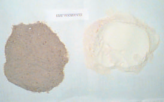
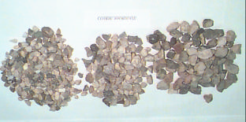
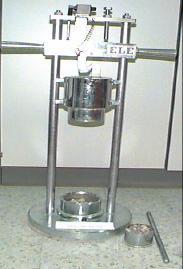

# Chapter 4 — Aggregate Impact Value Test

> CE 366 Transportation Engineering Laboratory. Converted to Markdown from `4-agg-impact test.pdf`; the original wording is kept as printed.

## 4.1 Introduction

Aggregates play an important role in the design and construction of highway and air filed pavements. They are also major part of rigid (concrete) and flexible (asphalt) pavements.

Aggregate is a combination of sand, gravel, crushed stone, or other material of mineral composition. Aggregate may be classified as natural or manufactured natural aggregates are taken from natural deposits without change in their nature during production, with the exception of crushing, sizing, grading or washing. Manufactured aggregates include blast furnace slag, clay, slate and lightweight aggregates. Further, the aggregates could be classified as fine and coarse. According to ASTM C125, fine aggregate is defined as aggregate passing no-4 (4.75 mm) sieve and retained on no. 200 (75 Micron m) sieve.

*Fig. 4.2 Fine Aggregate*

*Figure 4.1 Coarse Aggregate*

Coarse aggregate is defined as aggregate retained on no. 4 (4.75 Micron m) sieve.

Aggregates used in road construction should be strong enough to resist crushing under traffic wheel loads. If the aggregates are weak, the stability of the pavement structure is likely to be adversely affected.

Toughness is the property of a material to resist impact. Due to traffic loads, the road stones are subjected to the pounding action or impact and there is possibility of stones breaking into smaller pieces. The road aggregates should therefore be tough enough to resist fracture under impact.

In this test, a test specimen is compacted, in a standardized manner, into an open steel cup. The specimen is then subjected to a number of standard impacts from a dropping weight. This action breaks the aggregate to a degree which is dependent on the impact resistance of the material. This degree is assessed by sieving the impacted specimen and is taken as are aggregate impact value (AIV).

## 4.2 Objective

To determine the aggregate impact value of the given aggregate sample.

## 4.3 Apparatus

1. Impact testing machine, the machine consists of a metal base with a plane lower surface supported well on a firm floor. A detachable cylindrical cup, a metal hammer capable of sliding freely between vertical guides, and fall concentric over the cup. There is an arrangement for raising the hammer and allowing it to fall freely between vertical guides from a height of 38 cm in the test sample cup. A key is provided for supporting the hammer while fastening or removing the cup (Fig. 4.1).
2. A cylindrical measure.
3. Tamping rod.
4. BS sieve size 14 mm, 10 mm and 2.36 mm.
5. Balance, oven, rubber mallet, metal tray and brush, etc.

*Figure 4.1 Aggregate Impact Testing Machine* (numbered 4.1 again in the original)

## 4.4 Procedure

1. The test sample consists of the aggregates passing 14 mm and retained of 10 mm sieve. Wash the sample and dry at 100° to 110°C for four hours and cool to room temperature.
2. Fill the cylindrical measure by the aggregate sample to in three equal layers, each layer being given 25 tampings. Struck off the samples aggregate by tamping rod weigh and record the mass of the sample (M1).
3. Place the impact testing machine with its bottom plate flat on the floor so that hammer guides are vertical, fix the cup firmly in its position on the base of the machine and transfer the entire sample in the cup and compact it 25 times.
4. Raise the hammer and allow it to fall freely on the aggregates. The sample is subjected to a total of 15 such blows, each being delivered at an interval of not less than one second.
5. Remove the crushed aggregate from the cup and sieve from 2.36 mm sieve. The fraction passing the sieve is weighed (M2). The fraction retained on the sieve is also weighed (M3). If M2 + M3 differs from M1 by more than 1 g discard the results and repeat the test.

## 4.5 Calculations

The aggregate impact value is expressed as the percentage of the fines formed in terms of the total weight of the sample

$$\text{Aggregate Impact Value (AIV)} = \frac{100\,M_2}{M_1}$$

Where:

- $M_1$ = Mass of the test specimen
- $M_2$ = Mass of the test specimen passing 2.36 mm test sieve

## References

- British Standard Methods of four determination of aggregate impact value (AIV). B.S. 812: Part 112: 1990.
- Harold N. Atkins, Highway Materials, Soils and Concretes, 3rd Edition, Prentice Hall Inc
- Kenneth N. Derucher and George P. Korfiatis, Materials for civil d and highway engineers, Prentice Hall, NJ, 2nd edition, 1988.
- Harold N. Attkins, Highway materials, soils, and concretes, 3rd edition, Prentice Hall, 1990.
- Freddy L. Roberts, Prithivi S. Khandal et. al Hot Mix Asphalt Materials, Mixtures, Design and construction NAPA Foundation Maryland 199.
- Garber and Hoel, Traffic and Highway Engineering, 1990.

---

## Observation Sheet — Aggregate Impact Test

*CE 366 Transportation Engineering Laboratory*

| S. # | Details | Trial 1 | Trial 2 | Average |
|---|---|---|---|---|
| 1 | Total weight of aggregate sample filling the cylindrical measure = M₁ g | | | |
| 3 | Weight of aggregate retained on 2.36 mm sieve after the test = M₃ g | | | |
| 2 | Weight of aggregate passing 2.36 mm sieve after the test = M₂ g = M₁ − M₃ | | | |
| 4 | Aggregate impact value = percent fines = 100 M₂ / M₁ % | | | |
