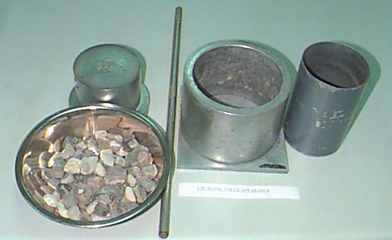

# Chapter 5 — Aggregate Crushing Value Test

> CE 366 Transportation Engineering Laboratory. Converted to Markdown from `5-Aggregate crushing value test.pdf`; the original wording is kept as printed.

## 5.1 Introduction

The aggregate crushing value provides a relative measure of resistance to crushing under gradually applied compressive loads. In this test an aggregate specimen is compacted in a standardized manner into a steel cylinder fitted with a freely moving plunger. The specimen is then subjected to a standard loading applied through the plunger. This action crushes the aggregate to a degree which is dependent on the crushing resistance of the material. This degree is assessed by a sieving test on the crushed aggregate and is taken as a measure of the aggregate crushing value (ACV).

## 5.2 Objective

To determine the aggregate crushing value (ACV) of the given aggregate sample.

## 5.3 Apparatus

1. Steel cylinder with open ends; square base plate, plunger of piston diameter 15 cm.
2. Cylindrical measure.
3. Steel tamping rod
4. Balance.
5. Compression testing machine capable of applying 400 kN at the rate of 40 kN/min.
6. Test sieves 14.0, 10.0 and 2.36 mm size.
7. Metal tray, brush, etc.

*Fig. 5.1 Crushing Value Apparatus* (labelled in the original: Tamping Rod, Plunger, Mold & Base Plate, Cylindrical Measure, Sample)

## 5.4 Procedure

1. The aggregate passing 14 mm and retained on 10 mm BS sieve is selected for standard test. The aggregate is washed, heated at 100°C to 110°C for 4 hours and then cooled to room temperature before test.
2. The cylindrical measures is filled by the test sample of aggregate in three layers, each layer being tamped by tamping rod. After the third layer, level the cylinder by tamping rod. Weight the sample (M1g).
3. The cylinder of the test apparatus is placed in position on the base plate and add the test specimen in three layers of approximately equal depth, each layer being subjected to 25 strokes by tamping rod. Carefully level the surface and insert the plunger so that it rests horizontally.
4. Place the cylinder between the platens of testing machine and apply the load of 400 kN in 10 min.
5. Release the load and remove the crushed aggregate and sieve through 2.36 mm BS sieve and find the mass of the material passing the sieve.

## 5.5 Calculations and Results

- Mass of test specimen = $M_1$ g
- Mass of material passing 2.36 mm sieve = $M_2$ g

$$\text{Aggregate Crushing Value (ACV)} = \frac{M_2}{M_1} \times 100$$

Report the average ACV

## References

- British Standard Methods for determination of aggregate crushing value BS 812, Part 110, 1990.
- Kenneth N. Derucher and George P. Korfiatis, Materials for civil and highway engineers, Prentice Hall, NJ, 2nd edition, 1988.
- Harold N. Attkins, Highway materials, soils, and concretes, 3rd edition, Prentice Hall, 1990.
- Freddy L. Roberts, Prithivi S. Khandal et. al Hot Mix Asphalt Materials, Mixtures, Design and construction NAPA Foundation Maryland 1991
- Asphalt Institute Amnual Series 2 (MS-2) Mix design methods for Asphalt Concrete 1988

---

## Observation Sheet — Aggregate Crushing Value Test

*CE 366 Transportation Engineering Laboratory*

| S. # | Details | Trial 1 | Trial 2 | Average |
|---|---|---|---|---|
| 1 | Total weight of aggregate sample filling the cylindrical measure = M₁ g | | | |
| 3 | Weight of aggregate retained on 2.36 mm sieve after the test = M₃ g | | | |
| 2 | Weight of aggregate passing 2.36 mm sieve after the test = M₂ g = M₁ − M₃ | | | |
| 4 | Aggregate impact value = percent fines = 100 M₂ / M₁ % | | | |
