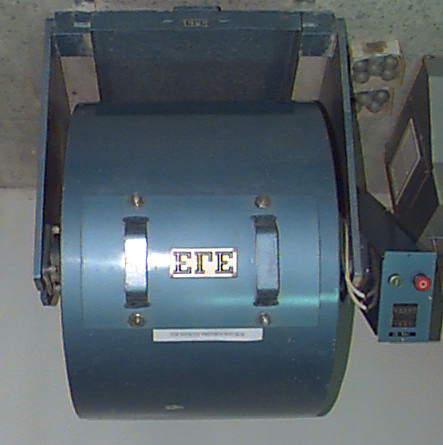

# Chapter 6 — Abrasion Value Test

> CE 366 Transportation Engineering Laboratory. Converted to Markdown from `6-Abrasion Value test.pdf`; the original wording is kept as printed.

## 6.1 Introduction

Due to the movements of traffic, the road aggregates are subjected to wearing action. Resistance to wear or hardness is an essential property of road aggregates, especially when used in wearing course. Therefore the aggregates should be hard enough to resist abrasion due to traffic. Abrasion test on aggregates are generally carried out by any one of the following methods:

1. Los Angeles abrasion test
2. Deval Abrasion test
3. Dorry Abrasion test

The Los Angeles Abrasion test is more common and is applicable in Kuwait.

The Los Angeles test is a measure of degradation of mineral aggregates of standard grading resulting from a combination of actions including abrasion, attrition, impact and grinding in a rotating steel drum containing, a specified number of steel spheres, the number depending upon the grading of test sample. As the drum rotates, a shelf plate picks up the sample and steel spheres carrying them around until they are dropped to the opposite side of the drum, creating an impact crushing effect. The contents then roll with in the drum with an abrading and grinding action until the shelf plate impacts and cycle is separated. After the prescribed number of revolutions, the contents are removed from the drum and the aggregate portion is sieved to measure the degradation as percent loss.

## 6.2 Objective

To determine the Los Angeles abrasion value of the given aggregate sample.

## 6.3 Apparatus

1. Los Angeles machine: consists of a hollow steel cylinder, closed at both ends, having inside diameter 70 cm and inside length 50 cm, mounted on slab shafts about which it rotates on a horizontal axis (Figure 6.1).
2. Abrasive charge: Consists of cast iron spheres approximately 4.7 cm in diameter and 390 to 445 g. in weight. The number of spheres used depends in sample grading (Table 6.1).
3. Sieves, balance, etc.

*Fig. 6.1 Los Angeles Machine* (labelled in the original: Charge (Steel Balls))

## 6.4 Procedure

1. Wash the test sample conforming to any of the sample grading (Table 6.1) and dry at 105-110°C to constant weight. Take the weight of the sample in gm (W1).
2. Place the sample in the cylinder along with the specified change. Fix the cover of the machine and rotate it at a speed of 30 to 33 rpm for 500 revolutions.
3. Discharge the material from the machine and make a preliminary separation of the sample on a sieve courses than 1.70 mm. Sieve the finer portion in a 1.70 mm sieve.
4. Wash the material coarser than 1.70 mm and over dry at 105-110°C to constant weight weigh in gm (W2).

## 6.5 Calculations

- Original weight of the sample = $W_1$ gm.
- Weight of aggregate retained on 1.70 mm sieve of the test = $W_2$ gm.

$$\text{Los Angeles abrasion value} = \frac{W_1 - W_2}{W_1} \times 100$$

The result of the Los Angeles Abrasion value is expressed as a percentage wear and the average value of two tests may be adopted.

### Table 6.1 Grading of Test Samples

| Sieve passing | Retained on | A | B | C | D |
|---|---|---|---|---|---|
| 37.5 mm (1½ in) | 25.0 mm (1 in) | 1 250 ± 25 | – | – | – |
| 25.0 mm (1 in) | 19.0 mm (¾ in) | 1 250 ± 25 | – | – | – |
| 19.0 mm (¾ in) | 12.5 mm (½ in) | 1 250 ± 10 | 2 500 ± 10 | – | – |
| 12.5 mm (½ in) | 9.5 mm (3/8 in) | 1 250 ± 10 | 2 500 ± 10 | – | – |
| 9.5 mm (3/8 in) | 6.3 mm (¼ in) | – | – | 2 500 ± 10 | – |
| 6.3 mm (¼ in) | 4.75 mm (No.4) | – | – | 2 500 ± 10 | – |
| 4.75 mm (No.4) | 2.36 mm (No.8) | – | – | – | 5 000 ± 10 |
| **Total** | | 5 000 ± 25 | 5 000 ± 10 | 5 000 ± 10 | 5 000 ± 10 |
| **No. of Spheres** | | 12 | 11 | 8 | 6 |
| **Wt. of Charge (g)** | | 5 000 | 4584 | 3330 | 2500 |

Sieve sizes are square openings. The weights are the weights of the indicated sizes, in g, for each grading (A to D).

## References

- ASTM – C131-90. Standard Test Method for resistance to Degradation of small-size coarse aggregate by abrasion and impact in Los Angeles Machine.
- Harold N. Atkins, Highway Materials, Soil & Concretes, Prentice Hall Inc. 1987.
- AASHTO – T96-87.
- Web page., www.mastrad.com/psvdoc.htm

---

## Data Sheet — Los Angeles Abrasion Test

*CE 366 Transportation Engineering Laboratory*

| | | | |
|---|---|---|---|
| i) Type aggregate = | | iv) Weight of charge = | |
| ii) Grading = | | v) # of revolution = | |
| iii) # of spheres used = | | | |

| | | Test 1 | Test 2 | Average Value |
|---|---|---|---|---|
| 1. | Weight of specimen = W₁ g | | | |
| 2. | Weight of specimen after abrasion test, coarser than 1.70 mm IS sieve = W₂ g | | | |
| 3. | Percentage wear = (W₁ − W₂) / W₁ × 100 | | | |
