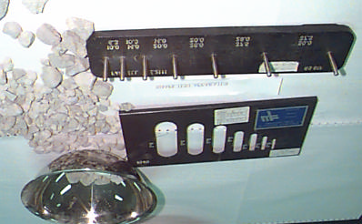

# Chapter 7 — Shape Test

> CE 366 Transportation Engineering Laboratory. Converted to Markdown from `7-aggregate shape test.pdf`; the original wording is kept as printed.

## 7.1 Introduction

The particle shape of aggregates is determined by the percentages of flaky and elongated particles. Flaky and elongated particles are considered undesirable as they cause weakness of the pavement. Rounded aggregates are preferred in cement concrete pavements as the workability of concrete improves. A regular shape of particles are desirable for granular base course due to increased stability desired from better interlocking. When the shape of aggregates deviates more from the spherical shape, as in the case of angular, flaky and elongated aggregate, the void content increases and hence the grain size distribution of the aggregates has to be suitably altered in order to obtain minimum voids in the dry mix on the maximum density.

## 7.2 Objective

To determine the flakiness and elongation indices of the given aggregate sample.

## 7.3 Flakiness Index

Aggregate particles are classified as flaky when they have a thickness (smallest dimension) of less than 0.6 of their mean sieve size. The flakiness index of an aggregate sample is found by separating the flaky particles and expressing their mass as a percentage of the mass of the sample tested. This test is not applicable to aggregate passing 6.30 mm sieve and retained as 63.0 mm sieve.

### 7.3.1 Apparatus

- Metal thickness gauge (Fig. 7.1)
- Test sieves, balance, trays, etc.

*Fig. 7.1 Shape Test Apparatus* (labelled in the original: Thickness Gauge, Length Gauge)

### 7.3.2 Procedure

1. The sieve sample with sieves mentioned in Table 7.1. Weigh each of the individual size fractions ($w_1, w_2, w_3, \ldots$) retained on these sieves, other than the 63.0 mm sieve and store them in separate trays marked with their size.
2. Gauge each fraction from the respective slots in the thickness gauge weigh pieces which pass through the slots ($x_1, x_2, x_3, \ldots$ etc.).

### 7.3.3 Calculations and Results

$$\text{Flakiness index} = \frac{(x_1 + x_2 + x_3 + \cdots) \times 100}{(w_1 + w_2 + w_3 + \cdots)}$$

Where $x_1, x_2, \ldots$ etc. are the weight of the fractions passing from the thickness gauge. $w_1, w_2, \ldots$, etc. are the weight of the original sample retained as the corresponding sieves.

## 7.4 Elongation Index

Aggregate particles are classified as elongated when they have a length (greatest dimension) of more than 1.8 of their mean sieve size, the elongation index is found by separating the elongated particles and expressing their mass as a percentage of the mass of sample tested. The test is not applicable to material passing 6.30 mm sieve or retained on 50 mm sieve.

### 7.4.1 Apparatus

Metal length gauge (Fig. 7.1). Test sieves, balance, trays, etc.

### 7.4.2 Procedure

1. Sieve the sample with sieves mentioned in Table (7.2) weight each of the individual size fractions ($w_1, w_2, w_3, \ldots$ etc.) retained on these sieves other than the 50.0 mm sieve.
2. Gauge each fraction as follows, select the length gauge appropriate to the single fraction under test and gauge each particle separately by hand. Elongated particles are those whose greatest dimension prevents them from passing through the gauge. Weigh each fraction which doesn't pass through the gauge ($y_1, y_2, \ldots$ etc.).

### 7.4.3 Calculation and Results

$$\text{Elongation index} = \frac{(y_1 + y_2 + y_3 + \cdots) \times 100}{(w_1 + w_2 + w_3 + \cdots)}$$

where: $y_1, y_2, y_3, \ldots$ weight of the fractions not passing through the length gauge; $w_1, w_2, w_3, \ldots$ are the weight of the original sample on the corresponding sieve.

### Table 7.1 Data for Determination of Flakiness Index

| BS test sieve nominal aperture — 100 % passing (mm) | 100 % retained (mm) | Width of slot in thickness gauge or special sieve ¹ (mm) | Minimum mass for subdivision (kg) |
|---|---|---|---|
| 63.0 | 50.0 | 33.9 ± 0.3 | 50 |
| 50.0 | 37.5 | 26.3 ± 0.3 | 35 |
| 37.5 | 28.0 | 19.7 ± 0.3 | 15 |
| 28.0 | 20.0 | 14.4 ± 0.15 | 5 |
| 20.0 | 14.0 | 10.2 ± 0.15 | 2 |
| 14.0 | 10.0 | 7.2 ± 0.1 | 1 |
| 10.0 | 6.30 | 4.9 ± 0.1 | 0.5 |

¹ This dimension is equal to 0.6 times the mean test sieve size.

### Table 7.2 Data for Determination of Elongation Index

| Test sieve — 100 % passing (mm) | 100 % retained (mm) | Gap between pins of length gauge ² (mm) | Minimum mass for subdivision (kg) |
|---|---|---|---|
| 50.0 | 37.5 | 78.7 ± 0.3 | 35 |
| 37.5 | 28.0 | 59.0 ± 0.3 | 15 |
| 28.0 | 20.0 | 43.2 ± 0.3 | 5 |
| 20.0 | 14.0 | 30.6 ± 0.3 | 2 |
| 14.0 | 10.0 | 21.6 ± 0.2 | 1 |
| 10.0 | 6.30 | 14.7 ± 0.2 | 0.5 |

² This dimension is equal to 1.8 times the mean test sieve size.

## References

- British Standards Methods of determination of particle shape BS 812, Part 105, 1989.
- Kenneth N. Derucher and George P. Korfiatis, Materials for civil and highway engineers, Prentice Hall, NJ, 2nd edition, 1988.
- Harold N. Attkins, Highway materials, soils, and concretes, 3rd edition, Prentice Hall, 1990.

---

## Observation Sheet — Aggregate Shape Test

*CE 366 Transportation Engineering Laboratory*

| Passing through IS sieve, mm (1) | Retained on IS sieve, mm (2) | Weight of the fraction consisting of at least 200 pieces, g (3) | Weight of aggregates in each fraction passing thickness gauge, g (4) | Weight of aggregates in each fraction retained on length gauge, g (6) |
|---|---|---|---|---|
| 63 | 50 | W₁ = | x₁ = | y₁ = |
| 50 | 37.5 | W₂ = | x₂ = | y₂ = |
| 37.5 | 28 | W₃ = | x₃ = | y₃ = |
| 28 | 20 | W₄ = | x₄ = | y₄ = |
| 20 | 14 | W₅ = | x₅ = | y₅ = |
| 14 | 10 | W₆ = | x₆ = | y₆ = |
| 10 | 6.3 | W₇ = | x₇ = | y₇ = |
| **Total** | | | | |

$$\text{Flakiness index (FI)} = \frac{(x_1 + x_2 + x_3 + \cdots)}{(W_1 + W_2 + W_3 + \cdots)} \times 100\,\% = \frac{100\,w}{W}\,\%$$

$$\text{Elongation index (EI)} = \frac{(y_1 + y_2 + y_3 + \cdots)}{(W_1 + W_2 + W_3 + \cdots)} \times 100\,\% = \frac{100\,x}{W}\,\%$$
